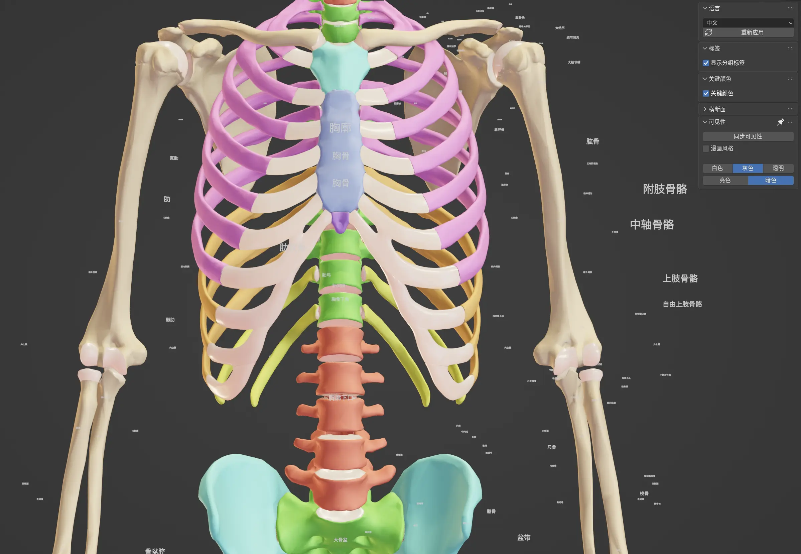

# Z-Anatomy Chinese Edition — Blender 5.0+ Compatibility and Improvements

[简体中文](README.md) | **English**

Based on the [official Z-Anatomy project](https://github.com/Z-Anatomy/Models-of-human-anatomy) and [Dean Song's Chinese edition](https://github.com/Dean-Song-1/z-anatomy-), this project adapts the atlas for Blender 5.0+ and improves compatibility and usability.

Original models and atlas: **Z-Anatomy**. Chinese translation: **Dean Song (@Dean-Song-1)**. Adaptation and improvements: **@hendasheng**. See [ATTRIBUTION.md](ATTRIBUTION.md) for detailed credits.

## Improvements

- Updated HUD font-size calls and Chinese font loading.
- Fixed missing language columns, empty translation fallback, Key colors checks, and redraw calls without an active area.
- Improved synchronization between object selection and the text editor, including muscle attachment name suffixes.
- Improved Chinese interface text, language selection, and terminology lookup.
- Preserved collection numbers and improved system visibility, number shortcuts, and Outliner expansion.
- Organized localized names, supplementary terminology, and multilingual glossary cards.

**Target: Blender 5.0+.** Per-version runtime test records are not yet available; support for every later version has not been verified.

## Download and install

1. Download **Z-Anatomy-cn-Blender-5.zip** from [Releases](https://github.com/hendasheng/Z-Anatomy-cn-Blender-5/releases). **Do not extract it.**
2. In Blender, click the **Blender icon at the top left → Install Application Template**, then select the downloaded ZIP.
3. Choose **File → New → Z-Anatomy** to open the atlas.

Use **File → New → Z-Anatomy** whenever you want to open it again.

## Repository contents

| Path | Contents |
|---|---|
| `src/Z-Anatomy/` | Template scripts and theme files |
| `patches/01-fixes.patch` | Six categories of crash and correctness fixes |
| `patches/02-zh-i18n.patch` | Chinese UI, fonts, and text synchronization |
| `patches/03-shortcuts.patch` | Collection visibility, shortcuts, and Outliner behavior |
| `data/` | Original Chinese terminology, supplementary entries, and applied comparison table |
| `ATTRIBUTION.md` | Sources and contributor credits |
| `UPSTREAM.md` | Relationship to the source projects |
| `RELEASE_NOTES.md` | Release notes |

Patches target the template's `__init__.py` and apply in order: 01, 02, 03. The script that applies all terminology to the scene and generates glossary cards is not included. **Patches and CSV files alone cannot rebuild the complete prepared scene.** Use the release attachment for the complete scene.

Earlier project records report 7036/7184 objects, 1719/1944 collections, 1659/1660 text labels, and 3350 glossary cards. These counts have not been recalculated during this publication pass.

## Licensing and credits

- Chinese terminology is credited to Dean Song. Data and documentation retain CC BY-SA 4.0; see [LICENSE](LICENSE).
- See [patches/LICENSE-NOTE.md](patches/LICENSE-NOTE.md) for code patch licensing.
- Original models and third-party content retain their respective licenses; see [License_Song1.txt](License_Song1.txt) and [ATTRIBUTION.md](ATTRIBUTION.md).
- The root LICENSE does not replace the individual licenses of models, code, fonts, or other third-party content.

## Known limitations

Some names and explanatory text in the scene remain in English. One original text data block has an encoding issue. Chinese terminology is inherited from the source project and has not undergone a term-by-term specialist review.
